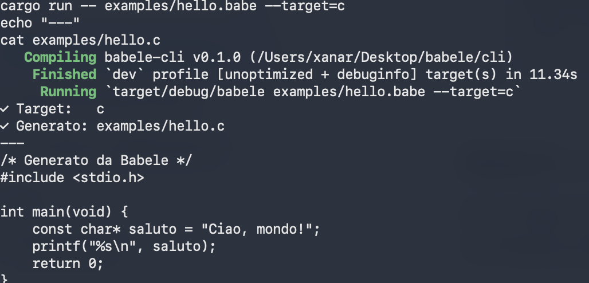

# Babele

> A universal source-to-source compiler. Write once, compile to 30+ languages.

## The Problem

Millions of lines of COBOL, Fortran and Ada run in production in banks, airlines and governments. The developers who wrote them are retiring. Rewriting them by hand costs millions of euros.

Babele solves this. You write modern code once, and Babele generates legacy code automatically - idiomatic, readable, and maintainable.

## Quick Start

git clone https://github.com/nowii-core/babele.git
cd babele
cargo build --release

Compile an example to C:

cargo run -- examples/hello.babe --target=c

Compile the same file to COBOL:

cargo run -- examples/hello.babe --target=cobol

## Example

Input - examples/hello.babe:

    fn main() {
        let saluto = "Ciao, mondo!";
        print(saluto);
    }

Output C - hello.c:

    /* Generato da Babele */
    #include <stdio.h>

    int main(void) {
        const char* saluto = "Ciao, mondo!";
        printf("%s\n", saluto);
        return 0;
    }

Output COBOL - hello.cob:

          * Generato da Babele
           IDENTIFICATION DIVISION.
           PROGRAM-ID. HELLO.
           DATA DIVISION.
           WORKING-STORAGE SECTION.
           01 SALUTO PIC X(12).
           PROCEDURE DIVISION.
               MOVE "Ciao, mondo!" TO SALUTO.
               DISPLAY SALUTO.
               STOP RUN.

Same input. Two completely different worlds.

## Supported Languages

Babele targets 30+ languages, spanning 72 years of computer science history - from 1949 to 2021.

Systems: C, C++, Rust, Assembly, Zig, Nim, D

Legacy Enterprise: COBOL, Fortran, Ada, Forth

Functional: Haskell, OCaml, Erlang, Elixir, Scala, F#, Standard ML

Formal Research: Lean 4, Coq (Rocq), Agda, Idris

Historical Influential: Simula 67, Smalltalk, Algol 68, APL, J, Common Lisp, Prolog

Configuration: Nix

See LANGUAGES.md for the complete list.

## Architecture

    source.babe
         |
         v
    Lexer / Parser       (OCaml)    -> AST
         |
         v
    Type Checker         (Haskell)  -> Typed AST
         |
         v
    IR Intermediate      (Rust)
         |
         v
    Optimizer            (Rust + Prolog)
         |
         v
    Code Generators      (C, C++, Rust, ASM, COBOL, Fortran, Ada, Forth, ...)

See ARCHITECTURE.md for details.

## Roadmap

- [x] Working compiler - C and COBOL backends
- [x] Project structure and documentation
- [x] First public release (v0.1.0)
- [ ] Full OCaml parser
- [ ] Haskell type inference
- [ ] Prolog optimizer integration
- [ ] Assembly backends (x86-64, ARM64, RISC-V)
- [ ] Distributed compilation with Erlang
- [ ] Stable release (v1.0.0)

See ROADMAP.md for the full plan.

## Why So Many Languages

Because no one has ever done it. Every other compiler supports 2-3 backends. Babele supports 30+.

Each backend is developed independently and attracts a different community:

- COBOL attracts enterprise developers maintaining banking systems.
- Fortran attracts scientists and HPC engineers.
- Ada attracts avionics and defense engineers.
- Haskell and OCaml attract compiler researchers.
- Coq, Agda and Lean 4 attract formal verification researchers.

Babele is not just a compiler - it is a bridge between worlds that never spoke to each other.

## Contributing

Every backend is independent. If you know COBOL, Fortran, Ada, or Forth - there is a place for you.

Open an issue to discuss which backend or feature you would like to work on.

## License

MIT - see LICENSE.
